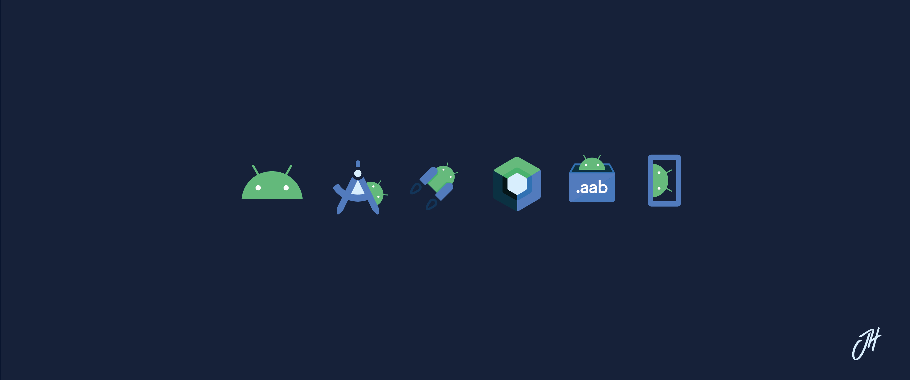

### Hi there, my name is Josael Hernandez 👋

<h3 tabindex="-1" class="heading-element" dir="auto">I'm a Senior Android Engineer</h3><a id="user-content-im-a-android-engineer" class="anchor" aria-label="Permalink: I'm a Android Engineer" href="#im-a-android-engineer"><svg class="octicon octicon-link" viewBox="0 0 16 16" version="1.1" width="16" height="16" aria-hidden="true"><path d="m7.775 3.275 1.25-1.25a3.5 3.5 0 1 1 4.95 4.95l-2.5 2.5a3.5 3.5 0 0 1-4.95 0 .751.751 0 0 1 .018-1.042.751.751 0 0 1 1.042-.018 1.998 1.998 0 0 0 2.83 0l2.5-2.5a2.002 2.002 0 0 0-2.83-2.83l-1.25 1.25a.751.751 0 0 1-1.042-.018.751.751 0 0 1-.018-1.042Zm-4.69 9.64a1.998 1.998 0 0 0 2.83 0l1.25-1.25a.751.751 0 0 1 1.042.018.751.751 0 0 1 .018 1.042l-1.25 1.25a3.5 3.5 0 1 1-4.95-4.95l2.5-2.5a3.5 3.5 0 0 1 4.95 0 .751.751 0 0 1-.018 1.042.751.751 0 0 1-1.042.018 1.998 1.998 0 0 0-2.83 0l-2.5 2.5a1.998 1.998 0 0 0 0 2.83Z"></path></svg></a>

I'm mobile developer with several years of experience on Android, IOS and Flutter.

<h2 tabindex="-1" class="heading-element" dir="auto">Skills:</h2><a id="user-content-skills" class="anchor" aria-label="Permalink: Skills:" href="#skills"><svg class="octicon octicon-link" viewBox="0 0 16 16" version="1.1" width="16" height="16" aria-hidden="true"><path d="m7.775 3.275 1.25-1.25a3.5 3.5 0 1 1 4.95 4.95l-2.5 2.5a3.5 3.5 0 0 1-4.95 0 .751.751 0 0 1 .018-1.042.751.751 0 0 1 1.042-.018 1.998 1.998 0 0 0 2.83 0l2.5-2.5a2.002 2.002 0 0 0-2.83-2.83l-1.25 1.25a.751.751 0 0 1-1.042-.018.751.751 0 0 1-.018-1.042Zm-4.69 9.64a1.998 1.998 0 0 0 2.83 0l1.25-1.25a.751.751 0 0 1 1.042.018.751.751 0 0 1 .018 1.042l-1.25 1.25a3.5 3.5 0 1 1-4.95-4.95l2.5-2.5a3.5 3.5 0 0 1 4.95 0 .751.751 0 0 1-.018 1.042.751.751 0 0 1-1.042.018 1.998 1.998 0 0 0-2.83 0l-2.5 2.5a1.998 1.998 0 0 0 0 2.83Z"></path></svg></a>

<b>Cross-platform</b> 

  
<b>Android</b> 

  
<b>iOS</b> 

  
<b>Tools</b> 

<h2 tabindex="-1" class="heading-element" dir="auto">Find me at:</h2><a id="user-content-find-me-at" class="anchor" aria-label="Permalink: Find me at:" href="#find-me-at"><svg class="octicon octicon-link" viewBox="0 0 16 16" version="1.1" width="16" height="16" aria-hidden="true"><path d="m7.775 3.275 1.25-1.25a3.5 3.5 0 1 1 4.95 4.95l-2.5 2.5a3.5 3.5 0 0 1-4.95 0 .751.751 0 0 1 .018-1.042.751.751 0 0 1 1.042-.018 1.998 1.998 0 0 0 2.83 0l2.5-2.5a2.002 2.002 0 0 0-2.83-2.83l-1.25 1.25a.751.751 0 0 1-1.042-.018.751.751 0 0 1-.018-1.042Zm-4.69 9.64a1.998 1.998 0 0 0 2.83 0l1.25-1.25a.751.751 0 0 1 1.042.018.751.751 0 0 1 .018 1.042l-1.25 1.25a3.5 3.5 0 1 1-4.95-4.95l2.5-2.5a3.5 3.5 0 0 1 4.95 0 .751.751 0 0 1-.018 1.042.751.751 0 0 1-1.042.018 1.998 1.998 0 0 0-2.83 0l-2.5 2.5a1.998 1.998 0 0 0 0 2.83Z"></path></svg></a>

<h2 tabindex="-1" class="heading-element" dir="auto">My Portafolio:</h2><a id="user-content-my-profile-app" class="anchor" aria-label="Permalink: My profile app:" href="#my-profile-app"><svg class="octicon octicon-link" viewBox="0 0 16 16" version="1.1" width="16" height="16" aria-hidden="true"><path d="m7.775 3.275 1.25-1.25a3.5 3.5 0 1 1 4.95 4.95l-2.5 2.5a3.5 3.5 0 0 1-4.95 0 .751.751 0 0 1 .018-1.042.751.751 0 0 1 1.042-.018 1.998 1.998 0 0 0 2.83 0l2.5-2.5a2.002 2.002 0 0 0-2.83-2.83l-1.25 1.25a.751.751 0 0 1-1.042-.018.751.751 0 0 1-.018-1.042Zm-4.69 9.64a1.998 1.998 0 0 0 2.83 0l1.25-1.25a.751.751 0 0 1 1.042.018.751.751 0 0 1 .018 1.042l-1.25 1.25a3.5 3.5 0 1 1-4.95-4.95l2.5-2.5a3.5 3.5 0 0 1 4.95 0 .751.751 0 0 1-.018 1.042.751.751 0 0 1-1.042.018 1.998 1.998 0 0 0-2.83 0l-2.5 2.5a1.998 1.998 0 0 0 0 2.83Z"></path></svg></a>

<table>
  <tr>
    <td align="center" width="160">
      <a href="https://play.google.com/store/apps/details?id=com.n1co.pay.app">
         
        <b>N1CO</b>
      </a>
    </td>
    <td align="center" width="160">
      <a href="https://play.google.com/store/apps/details?id=com.yummy.customer">
         
        <b>Yummy</b>
      </a>
    </td>
    <td align="center" width="160">
      <a href="https://play.google.com/store/apps/details?id=com.bancohipotecario.android">
         
        <b>Banco Hipotecario</b>
      </a>
    </td>
  </tr>
  <tr>
    <td align="center" width="160">
      <a href="https://play.google.com/store/apps/details?id=com.afp.crecer.app.android">
         
        <b>AFP Crecer</b>
      </a>
    </td>
    <td align="center" width="160">
      <a href="https://play.google.com/store/apps/details?id=com.excelautomotriz.excelOnline">
         
        <b>Excel App</b>
      </a>
    </td>
    <td align="center" width="160">
      <a href="https://play.google.com/store/apps/details?id=mobilesv.gourmetexpress">
         
        <b>Gourmet Express</b>
      </a>
    </td>
  </tr>
  <tr>
    <td align="center" width="160">
      <a href="https://play.google.com/store/apps/details?id=com.mobilesv.lacalaca">
         
        <b>LACA LACA</b>
      </a>
    </td>
    <td align="center" width="160">
      <a href="https://play.google.com/store/apps/details?id=com.mobilesv.samix">
         
        <b>Radio Corporación</b>
      </a>
    </td>
    <td align="center" width="160">
      <a href="https://play.google.com/store/apps/details?id=com.mobilesv.ccsb">
         
        <b>Drink Incidence</b>
      </a>
    </td>
  </tr>
</table>

<h2 tabindex="-1" class="heading-element" dir="auto">Contact me:</h2><a id="user-content-contact-me" class="anchor" aria-label="Permalink: Contact me:" href="#contact-me"><svg class="octicon octicon-link" viewBox="0 0 16 16" version="1.1" width="16" height="16" aria-hidden="true"><path d="m7.775 3.275 1.25-1.25a3.5 3.5 0 1 1 4.95 4.95l-2.5 2.5a3.5 3.5 0 0 1-4.95 0 .751.751 0 0 1 .018-1.042.751.751 0 0 1 1.042-.018 1.998 1.998 0 0 0 2.83 0l2.5-2.5a2.002 2.002 0 0 0-2.83-2.83l-1.25 1.25a.751.751 0 0 1-1.042-.018.751.751 0 0 1-.018-1.042Zm-4.69 9.64a1.998 1.998 0 0 0 2.83 0l1.25-1.25a.751.751 0 0 1 1.042.018.751.751 0 0 1 .018 1.042l-1.25 1.25a3.5 3.5 0 1 1-4.95-4.95l2.5-2.5a3.5 3.5 0 0 1 4.95 0 .751.751 0 0 1-.018 1.042.751.751 0 0 1-1.042.018 1.998 1.998 0 0 0-2.83 0l-2.5 2.5a1.998 1.998 0 0 0 0 2.83Z"></path></svg></a>

<!--
**josaeljjh/josaeljjh** is a ✨ _special_ ✨ repository because its `README.md` (this file) appears on your GitHub profile.

Here are some ideas to get you started:

- 🔭 I’m currently working on ...
- 🌱 I’m currently learning ...
- 👯 I’m looking to collaborate on ...
- 🤔 I’m looking for help with ...
- 💬 Ask me about ...
- 📫 How to reach me: ...
- 😄 Pronouns: ...
- ⚡ Fun fact: ...
-->
